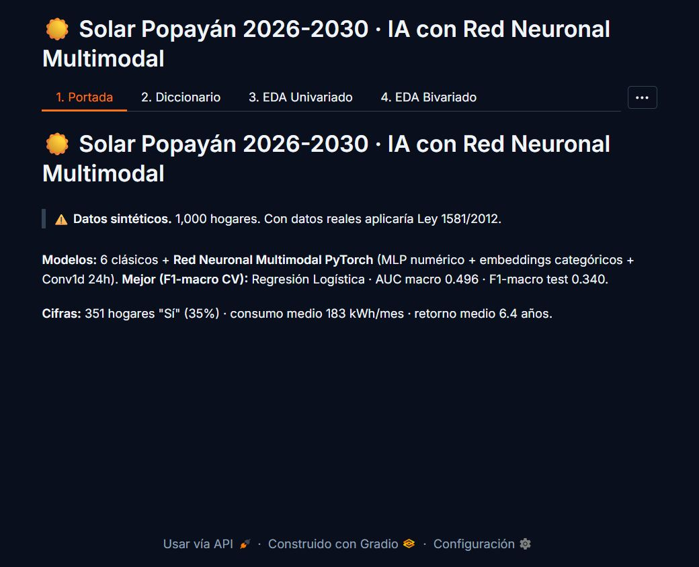

# Despliegue Gradio del proyecto integrador

**URL:** https://cfba95d1145ff24ad5.gradio.live/ (enlace público temporal de Gradio, ~72 h)

Aplicación generada por la Celda 2 de [`notebooks/proyecto.ipynb`](../notebooks/proyecto.ipynb), expuesta públicamente desde Colab con el túnel de la Celda 3 (ngrok/Gradio share). No es la misma salida que el [sitio estático de Vercel](../sitio-web/README.md): usa un dataset sintético distinto.

## Contenido

24 pestañas: Portada, Diccionario, EDA Univariado, EDA Bivariado, EDA Multivariado, Correlación, Target, Pareto, Comparación Modelos, Red Neuronal, Métricas, Calibración, SHAP, Fairness, Predicción Adopción, Predicción Ahorro, K-Means, Jerárquico, Anomalías, Series, Pronóstico, Optimización, RAEE y Conclusiones.

## Cifras que muestra

- 1.000 hogares sintéticos, con aviso de Ley 1581/2012 para datos reales.
- **351 hogares "Sí" (35 %)**, consumo medio **183 kWh/mes**, retorno medio **6,4 años**.
- Modelos: 6 clásicos + red neuronal multimodal PyTorch (MLP numérico + embeddings categóricos + Conv1d de 24 h).
- Mejor modelo por F1-macro en validación cruzada: **Regresión Logística** (AUC macro 0,496; F1-macro test 0,340).

## Conclusiones (pestaña 23)

- Mejor clasificador por validación cruzada: **Regresión Logística** (AUC macro 0,496; F1-macro test 0,340).
- La comparativa incluye la red neuronal multimodal PyTorch con rama Conv1d sobre el perfil horario de 24 h.
- SHAP aplicado sobre Random Forest; Permutation Importance sobre el modelo final.
- Auditoría de equidad por estrato, zona y género del jefe del hogar.

## Descargas disponibles

La pestaña Conclusiones ofrece un **ZIP de 17,7 MB** (`resultados_proyecto_solar_popayan.zip`) con 108 archivos: 1 metadata, 52 gráficos HTML interactivos, 38 tablas CSV y 17 modelos (`.joblib`, `.pt`, `.json`). También permite descargar cada archivo por separado.

El paquete completo se conservó en [`entregables/`](../../../entregables/INVENTARIO.md) de este repositorio; allí está el inventario detallado. Las descargas individuales equivalen a los archivos del ZIP.

## Relación con el resto del proyecto

| Salida | Dataset que usa | Cifras clave |
| --- | --- | --- |
| Esta app Gradio | Generado por la Celda 1 del notebook | 35 % "Sí"; 183 kWh/mes; retorno 6,4 años |
| Sitio de Vercel | Coincide con `datos/solar_popayan/dataset_solar_popayan.csv` | 40 % "Sí"; 111,5 kWh/mes; retorno ~10 años |

Esto confirma el hallazgo documentado en el README del Módulo 7: el generador de la Celda 1 produce una distribución diferente a la del dataset versionado. Para que ambas salidas sean comparables hay que copiar el CSV del repo a `/content/` antes de ejecutar la Celda 1.

## Estado de la revisión

- La interfaz carga y responde correctamente.
- Se observó un aviso no crítico en consola: `Unable to preload CSS for https://gradio.s3-us-west-2.amazonaws.com/assets/index-...css` (la app se renderiza igual).
- El enlace es temporal: si expira, se regenera ejecutando las Celdas 2 y 3 del notebook con un `NGROK_AUTHTOKEN` válido (nunca pegado en el código).
